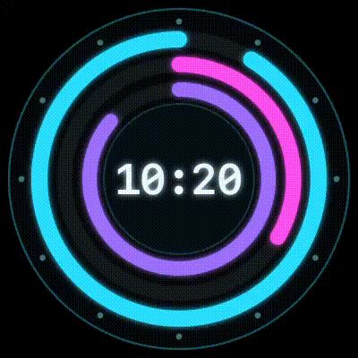

# Flock

An always-on-top clock in a frameless, transparent 220×220 window.
Tauri v2 + React 19 + TypeScript, SVG analog skins or a digital readout with an editable
ISO-style pattern and six bundled typefaces, tray menu, click-through mode, IANA time zones.

## Versions assumed

| Package | Version |
| --- | --- |
| `tauri` (crate) | 2.12.5 |
| `tauri-build` | 2.7.4 |
| `tauri-plugin-store` | 2.5.0 |
| `tauri-plugin-dialog` | 2.8.4 |
| `tauri-plugin-global-shortcut` | 2.4.1 |
| `tauri-plugin-autostart` | 2.7.0 |
| `serde` / `serde_json` | 1.0.229 / 1.0.154 |
| `@tauri-apps/cli`, `@tauri-apps/api` | 2.12.4 |
| `@tauri-apps/plugin-dialog` | 2.8.4 |
| `react`, `react-dom` | 19.3.1 |
| `@types/react`, `@types/react-dom` | 19.3.0 |
| `vite` / `@vitejs/plugin-react` | 8.3.5 / 6.2.1 |
| `typescript` | 5.9.3 |
| Rust | 1.90+ (plugins require it) |

## Structure

```
index.html
package.json
tsconfig.json
vite.config.ts
src/
  main.tsx                 createRoot + Suspense, routes clock vs settings by window label
  App.tsx                  settings/skin orchestration, tray "choose skin" handler
  SettingsApp.tsx          settings window: display mode, format, font, size, style
  styles.css               transparent html/body/#root, clock + settings styles
  assets/fonts/            vendored woff2 faces + generated fonts.css + LICENSE.md
  components/Clock.tsx     drag region, analog skin host or digital text node
  hooks/useClockLoop.ts    rAF / 1s loop, direct setAttribute or textContent writes
  hooks/useSettings.ts     useSyncExternalStore over lib/settings
  hooks/useWindowVisible.ts visibility + Tauri event pause
  lib/colors.ts            neon palette + glow/colour style helpers
  lib/format.ts            token formatter for the digital display (HH:mm, yyyy-MM-dd…)
  lib/fonts.ts             the six typefaces and their CSS stacks
  lib/settings.ts          typed snapshot store (subscribe/getSnapshot)
  lib/skins.ts             built-in + custom skins, cached, safe fallback
  lib/sanitize-svg.ts      DOMParser sanitizer + id validation
  lib/time.ts              Intl time-zone math, hand angles
  skins/default.svg, minimal.svg, dial.svg, neon.svg, bauhaus.svg
src-tauri/
  src/main.rs, lib.rs
  src/settings.rs          Settings model, plugin-store writer, commands
  src/tray.rs              tray menu + checkmark sync
  src/win.rs               bounds restore/persist, square lock, visibility,
                           settings window creation/placement
  tauri.conf.json
  capabilities/default.json
  icons/                   generated app icons + tray.png (template glyph)
scripts/generate-icons.mjs regenerates the two source PNGs
scripts/fetch-fonts.mjs    re-vendors the font files from Google Fonts
```

## Run

```bash
npm install
npm run tauri dev      # dev window + Vite on :1420
npm run tauri build    # dmg/app (macOS), msi+nsis (Windows), deb+AppImage (Linux)
```

Prerequisites: Node 20.19+/22.12+, Rust 1.90+, and the platform webview
(WebKitGTK 4.1 + `libayatana-appindicator3` on Linux, WebView2 on Windows).

### Scaffolding the same project from scratch

The repository is already complete; these are the equivalent bootstrap commands.

```bash
npm create tauri-app@latest flock -- --template react-ts --manager npm
cd flock
npx tauri add store
npx tauri add dialog
npx tauri add global-shortcut
npx tauri add autostart
# React 19 upgrade (the template may ship an older major)
npm install react@19.3.1 react-dom@19.3.1
npm install -D @types/react@19.3.0 @types/react-dom@19.3.0
npm install -D vite@8.3.5 @vitejs/plugin-react@6.2.1 typescript@5.9.3 @types/node@24.19.2
npx tauri icon src-tauri/icons/app-icon.png
```

## Architecture notes

- **Settings have exactly one writer.** `tauri-plugin-store` is opened and written from
  Rust (`src-tauri/src/settings.rs`), which keeps tray checkmarks and the webview from
  racing over a stale in-memory cache. The webview gets a typed read-only mirror through
  `get_settings` + the `settings://changed` event, wrapped in `lib/settings.ts` with
  `subscribe`/`getSnapshot` for `useSyncExternalStore`. The JS `plugin-store` package is
  therefore intentionally not a dependency.
- **The clock never re-renders per frame.** `useEffect` resolves `#hour-hand`,
  `#minute-hand`, `#second-hand` once per skin and writes `transform="rotate(deg cx cy)"`.
  React renders only on settings/skin/visibility changes.
- **A ring skin reports progress, not angles.** Rings carry `pathLength="1"`, so the
  painter writes `stroke-dasharray="<0..1> 1"` (a fraction of the ring, starting at twelve
  because the group is rotated -90°) instead of a `transform`; an optional `#center-label`
  `<text>` gets a live `HH:mm` for the clock's time zone, rewritten only when the minute
  changes. Neon is such a skin: seconds ring outermost, then minutes, then hours, three
  colours, `HH:mm` in the middle. The seconds ring alternates one minute at a time, both
  phases clockwise: one minute is eaten from twelve towards the hand (a positive
  `stroke-dashoffset` slides the dash forward, so the survivor is the arc behind the
  hand), the next minute fills from twelve the normal way. Each phase ends exactly where
  the next one starts — full meets full, empty meets empty — so nothing jumps. The minute
  and hour rings keep filling clockwise.
- **Skins are sanitized before they reach the DOM.** `lib/sanitize-svg.ts` parses with
  `DOMParser`, drops `script`/`foreignObject`/`image`/media elements, strips `on*`
  attributes, `javascript:`/`vbscript:`/`data:text/html` values, non-`#` `href`/`url()`
  references and `@import`, then requires a `viewBox` plus a way to draw the time: all three
  hands (`#hour-hand`, `#minute-hand`, `#second-hand`) or all three rings (`#second-ring`,
  `#minute-ring`, `#hour-ring`). Invalid files fall back to the built-in default and show a
  notice.
- **Five built-in skins, two entry points.** Default, Minimal, Classic (paper face, gold
  case, serif numerals), Neon (dark glass, glowing two-tone ring) and Bauhaus (primary
  red quarter arc, black bars). `BUILTIN_SKINS` exists twice — `lib/skins.ts` for the
  picker and the clock, `tray.rs` for the menu — and the keys/labels must stay in step.
  Both the tray's Skin submenu and the analog Settings panel write the same `skinPath`;
  the panel draws each skin as a tile with the hands posed at ten past ten, and its
  "Load custom SVG…" button runs the same picker + sanitizer as the tray entry.
- **Smooth mode is capped at 30 fps** (still visually smooth, roughly half the idle work of
  60 fps); tick mode aligns to the wall-clock second with `setInterval`.
- **The digital display reuses the same single-writer setting** (`displayMode`,
  `digitalFormat`, `font`, `digitalSize`, `digitalBackdrop`, `digitalNeon`, `digitalColor`)
  and is painted by the same loop with `textContent`, so it also ticks once per second
  instead of re-rendering React. Colour and neon glow are inline styles (`lib/colors.ts`),
  which the loop never touches. The settings window is a second
  webview (`label: "settings"`) that routes to `SettingsApp` in `main.tsx`; both windows get
  live updates through `settings://changed`.

## Manual test checklist

### macOS

- [ ] Window is 220×220, frameless, transparent, always on top, absent from the Dock's app switcher list behaviour is unchanged (see limitations).
- [ ] Double click the clock: the Settings panel opens beside it, in both analog and digital mode.
- [ ] Drag anywhere on the clock to move it; dragging an edge must not resize it. In analog mode the window stays square (Size slider) and the face scales to fill it; position/size survive quit + relaunch.
- [ ] `Cmd+Shift+O` toggles click-through both ways; tray "Click-through" also restores input.
- [ ] Tray: Show/Hide label flips, Always on top checkmark toggles, opacity 100/80/60/40 applies, all five built-in skins load and can also be picked in Settings → Skin (tiles show the same face, hands at ten past ten), custom SVG loads or is rejected with a notice, time zone changes the displayed time, Launch at login adds/removes the login item.
- [ ] Tray → Settings… opens the panel beside the clock; switching to Digital shows `HH:mm`, typing `hh:mm:ss A` or `yyyy-MM-dd HH:mm` updates the clock live, each of the six fonts renders in its own face, the Size slider (10–100 px) resizes the readout and the window hugs it, and Style → colour swatch + "Neon glow" + "Dark backdrop" repaint it (off = transparent, floating time).
- [ ] Minimise or hide the clock: CPU drops to ~0% in Activity Monitor; restore and it resumes on the correct second.
- [ ] Activity Monitor: idle CPU < 1% in tick mode, RAM is a Tauri webview baseline (no growth over 10 min).

### Windows 10/11

- [ ] `npm run tauri build` produces `.msi` and `.exe` (NSIS, per-user) installers; installed app launches from Start menu.
- [ ] No white flash on first paint; window is transparent with no border/shadow.
- [ ] Tray icon appears in the notification area; menu items work; "Launch at login" writes `HKCU\...\Run`.
- [ ] `Ctrl+Shift+O` toggles click-through; tray restores it.
- [ ] Dragging the clock moves it but never resizes it; the Size slider keeps the window square in analog mode, the digital readout stays hugged, and drag persists across restart.
- [ ] Taskbar shows no entry (`skipTaskbar`).

### Linux (X11)

- [ ] Always-on-top is honoured by the WM; window has no decorations and no taskbar entry.
- [ ] Tray icon shows (needs `libayatana-appindicator3`); menu opens on click.
- [ ] Click-through works and `Ctrl+Shift+O` recovers input.
- [ ] `~/.config/autostart/<app>.desktop` appears/disappears with "Launch at login".
- [ ] `.deb` installs and runs; AppImage runs; both pick up the bundled icons.

### Linux (Wayland)

- [ ] Menu shows the disabled "⚠ Always-on-top may be ignored on Wayland" item when `XDG_SESSION_TYPE=wayland`.
- [ ] Document/verify compositor behaviour: always-on-top and click-through may be ignored; GNOME needs the AppIndicator extension for the tray.
- [ ] Clock still renders, drags and persists bounds (via XWayland if the platform falls back to it).

## Known limitations

- **The settings window is created on demand** from the tray ("Settings…"), so it is not
  part of the clock's always-on-top stack. It opens beside the clock when there is room on
  the monitor, otherwise centred; while it is open, clicking the clock still drags the clock.
- **Digital formats are token based, not ICU complete.** Supported: `HH H hh h mm m ss s`,
  `a A`, `EEE EEEE`, `yyyy yy`, `MMMM MMM MM M`, `dd d`. Literal text must be quoted
  (`HH:mm 'UTC'`) because token letters are matched first (`at` would render as `AMt`).
  `\n` starts a new line (`HH:mm\nEEE` shows the time above the weekday); the format
  field is single-line, so that escape is the only way to break it. Any other backslash
  quotes the next character, which is how a token letter is printed literally (`\h`). The
  hug measures the whole block, so a two-line readout gets a window twice as tall, and the
  preview in Settings breaks the same way.
- **Digital size is the user's choice, in CSS pixels** (`digitalSize`, 10–100, default
  44), never a function of the pattern or of the window. The window hugs the readout: on
  every size/format/font change the webview measures the text and calls
  `resize_clock_box`, so the clock is the readout's own box plus a glow margin — a
  rectangle in digital mode, because a square can never be snug around
  a single line (clamped to 1600 × 1200). The per-second repaint never resizes, so a
  manual drag sticks until the next settings change. `digitalFit` (default on) is the
  fallback for a manual squeeze: below the text's natural size the readout wraps at
  spaces and hyphens (`HH:mm` is never broken mid-token) and `fitDigital` bisects the
  glyph box with a `Range` for the largest size that still fits; with it off the window
  edge clips instead. A long format therefore reads at full size in a wide window rather
  than shrinking to a square.
- **The glow margin is a share of the type size.** With "Neon glow" on, the clock keeps
  0.3 × `digitalSize` free on each side (`GLOW_PAD_RATIO` in `Clock.tsx`, passed to CSS as
  `--clock-pad`) so `text-shadow` is not cut at the window edge; the hug measures it, and
  with the glow off the padding is 0 and the window is the glyph box itself. The "Dark
  backdrop" pill adds `0.1em`/`0.22em` of its own, also picked up by the hug.
- **The neon palette is fixed** (seven colours in `src/lib/colors.ts`); the pill background
  is a toggle, not a colour picker. A glow over a light wallpaper is weak by nature, so
  leave "Dark backdrop" on for busy desktops, and note that glow is a CSS `text-shadow`
  (no blur of the glyph itself), so it costs GPU time on very large type.
- **Fonts are vendored** (`src/assets/fonts`, ~112 KB, latin subset). Changing families
  means editing `scripts/fetch-fonts.mjs` and re-running it; nothing is fetched at runtime.
- **The analog face scales with its window.** A skin fills the webview
  (`width: 100%; height: 100%` plus `preserveAspectRatio="xMidYMid meet"`), so the face is
  always as big as the square window it lives in. The side is set from the Size slider in
  Settings (analog only, `MIN_SIDE`–`MAX_SIDE` = 120–1200 px, written as `width`/`height`);
  the mouse only moves the window.
- **The analog square is enforced in software.** Tauri v2.12 exposes no native
  aspect-ratio constraint (`WindowSizeConstraints` has only min/max), so `win.rs` snaps
  the window back to a square on `Resized` while `displayMode` is analog; the digital
  clock is left free so it can hug its readout.
- **A mouse drag only ever moves the window.** Sizing is a settings concern: the Size
  slider (and the hug path for digital) writes `width`/`height` through Rust, so a stray
  edge drag cannot leave the clock at an odd size, and no resize affordance has to be
  drawn on a borderless window. There is no JS resize handler and no
  `core:window:allow-start-resize-dragging` permission any more, and `win::setup` drops
  the macOS resizable style mask (`set_resizable(false)`), because a borderless window
  that keeps that mask still gets an invisible native edge-drag frame. tao's macOS
  `set_resizable` only edits the mask, so restore, the analog Size slider and the digital
  hug keep setting the size programmatically; GTK is left resizable on purpose, since
  `set_resizable(false)` there pins the window to its natural size and the hug would stop
  working.
  A double click anywhere on the clock calls `show_settings`, the same Rust path the tray
  uses.
- **The drag is hand-rolled on macOS only** (`src/lib/drag.ts`). There tao hands the press to
  `performWindowDragWithEvent:` with an `NSApp.currentEvent` that, by the time the IPC lands,
  is a different event — or nil, and it fabricates a mouse-down. The window picks up a wrong
  grab anchor: it jumps away from the cursor, and even a plain click shifts it. So on macOS
  the clock reads its own origin once per press and writes `setPosition(origin + cursor
  travel)` on the next animation frame: exact grab point, absolute maths so dropped frames
  cannot drift, and nothing at all moves until the pointer travels 3 px — which is why a
  click that only focuses the app no longer nudges the clock. Windows anchors its native
  drag on `GetCursorPos` and GTK on the pointer position, so both keep the OS drag; it is
  also the only option on Wayland, where a client may not position its own window. That is
  what the tiny `platform` command is for.
- **macOS above fullscreen is best-effort.** `set_visible_on_all_workspaces(true)` plus
  always-on-top joins all spaces, but Tauri does not expose
  `NSWindowCollectionBehaviorFullScreenAuxiliary`; floating over another app's fullscreen
  space may not work.
- **macOS Dock icon remains.** `skipTaskbar` is a no-op on macOS; hiding the Dock icon needs
  `LSUIElement`/`ActivationPolicy::Accessory`, which was not requested.
- **Opacity is CSS opacity on the clock**, not native window alpha (Tauri 2.12 has no
  `set_opacity`). Because the window is transparent the visual result is the same.
- **`macOSPrivateApi` is a no-op since Tauri 2.12.1** (the APIs are always enabled); the key
  is kept because the project asks for it, and the `macos-private-api` Cargo feature is on.
- **Custom skins are restricted by design:** no `<script>`, `<foreignObject>`, `<image>`,
  event handlers, external `href`/`url()` or `@import`. Files need `viewBox` and the three
  hand ids; a square viewBox is required for the hands to pivot correctly.
- **Time zones are a curated 24-entry list** (plus "System"). `Intl.supportedValuesOf`
  would allow every IANA zone, but a 400-entry tray submenu is unusable; add entries in
  `src-tauri/src/tray.rs` if you need more.
- **Wayland:** always-on-top, click-through and global shortcuts depend on the compositor;
  X11 is the supported Linux target.
- **Smooth mode is 30 fps**, not display refresh rate, to keep idle CPU low.
- **No signing/notarization** is configured; macOS builds are unsigned and Windows installers
  are unsigned, so OS warnings are expected.
- **React Compiler is not enabled.** `@vitejs/plugin-react` 6 would route it through Babel,
  which is extra build machinery for a tree that renders once per settings change.
- **Not measured:** idle CPU/RAM figures. Measure with Activity Monitor / Task Manager /
  `ps` after a release build; the design targets < 1% idle in tick mode.

Demo
<p align="center">
  
</p>